# 商衡SI 系统使用说明书

| 项目 | 内容 |
|-|-|
| 适用版本 | V3.6.2 |
| 读者 | 使用篇：全体使用人员；管理篇：业务管理员、系统管理员 |
| 日期 | 2026-11-28 |

本说明书的截图来自演示环境，合同、公司、人名、金额均为虚构。你看到的菜单按你的权限显示，可能比截图少几项。

---

# 使用篇

## 1 使用前须知

商衡SI 是公司内网里的商务文件初审工具。它先在公司服务器上把文件里的单位、人名、电话、账号、金额等遮住，换成代号，经你确认后才把文字交给云端大模型；结果回来后在本机换回真实名称。

请记住四点：

1. **原件不出公司**：发给模型的只有遮住后的文字，不发原文件、图片、录音和文件名。
2. **确认页要看一眼**：系统拿不准的内容会默认遮住，但客户简称、项目代号、产品型号等最好由你确认。
3. **结果仅供参考**：审核意见由 AI 生成，重大事项请由法务、合规人员确认。
4. **只有你能看到你的任务**：管理员也打不开别人的文件和结果。

## 2 开始使用

### 2.1 浏览器与证书

- 使用 Windows 10 / 11 上的最新版 **Edge** 浏览器（同内核的 Chrome 也可以），窗口宽度不小于 1280 像素。
- 第一次使用前安装一次根证书：在浏览器打开 `http://<服务器地址>/cert/`，按页面说明下载根证书，在下载文件夹中核对指纹后，导入到“当前用户”的“受信任的根证书颁发机构”。之后用 `https://<服务器地址>` 访问，地址栏不再提示“不安全”。登录页的“下载根证书”也能打开这个说明页。

### 2.2 登录

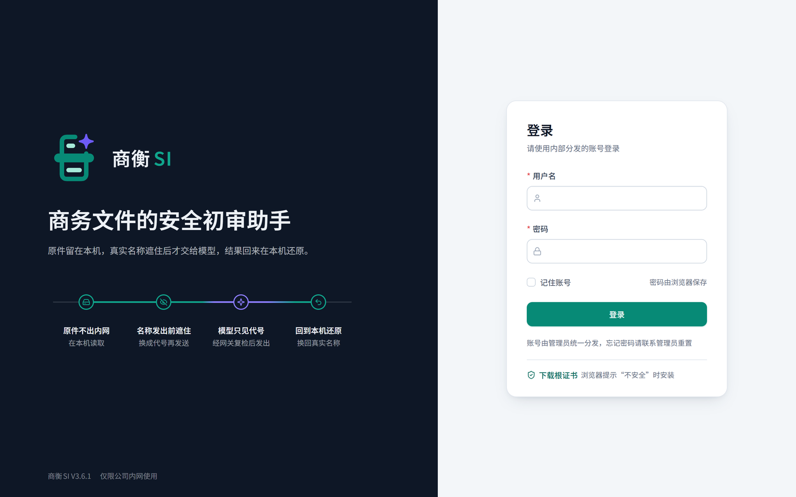

1. 输入管理员发给你的用户名和初始密码，点“登录”。
2. 第一次登录或管理员重置密码后，系统要求设置新密码：至少 8 位，同时包含字母和数字。
3. 勾选“记住账号”后，浏览器会记住用户名；密码由浏览器自带的密码管理器保存。

连续 5 次输错密码，账号锁定 15 分钟。忘记密码请联系管理员重置。超过 8 小时不操作会自动退出登录。

### 2.3 界面介绍

| 区域 | 内容 |
|-|-|
| 左侧侧栏 | 新建会话；工作台；文件审查（文件审核、合同对比、标书初审）；工具（会议纪要、翻译、发票管家）；历史记录；搜索；近期会话 |
| 侧栏底部 | 你的名字，点开为账号菜单：设置、外观、修改密码、退出 |
| 主区域 | 当前功能页面 |

- 侧栏可以拖动调整宽度，也可以点左上角按钮收成图标窄栏。
- **搜索**（Ctrl+K）：查找本人的审核、会话、标书项目和审核问题，也可以直接跳到某个页面或新建审核。

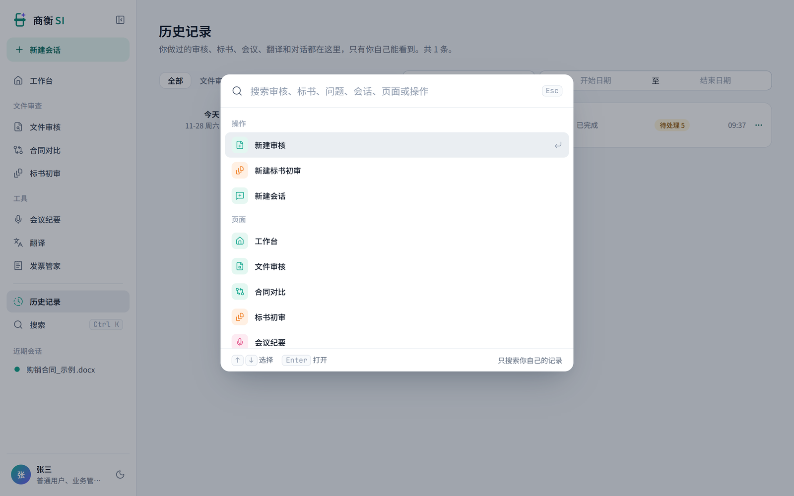

### 2.4 安装到桌面（可选）

在 Edge 中打开系统后，点地址栏右侧的“应用可用”图标或菜单中的“应用 → 将此站点作为应用安装”，桌面上会出现商衡SI 图标，打开后是独立窗口。

### 2.5 工作文件夹（可选）

在工作台会话的文件面板中点“选择工作文件夹”，授权一个本机文件夹。之后可以“从工作文件夹选择”勾选文件加入，导出的文件也会自动存入这个文件夹（同名时加序号，不会覆盖）。系统不会读取你没有勾选的文件，文件夹路径和文件名也不会发到服务器。

## 3 文件审核

适用于合同、报价单、订单 / 供货单、询价函、函件。支持 Word（DOCX、DOC、WPS、RTF）、PDF（文字版和扫描件）、Excel（XLSX、XLS、ET）、JPG、PNG。每次最多 10 个文件，单个不超过 30 MB。

### 3.1 上传

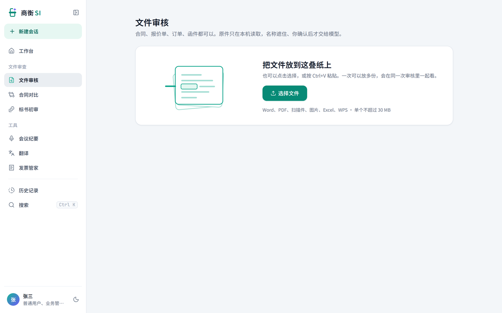

1. 点侧栏“文件审核”。
2. 把文件拖到页面上，或点“选择文件”，也可以按 Ctrl+V 粘贴。可以一次放多份，比如合同加附件报价单，会在同一次审核中一起看。
3. 系统自动开始读取，每个文件一行显示进度；扫描件需要逐页识别文字，耗时稍长。

下方“最近的审核”列出最近 5 次审核，点一行可以继续。

### 3.2 确认脱敏

读取完成后进入确认页。这是整个流程里最重要的一步。

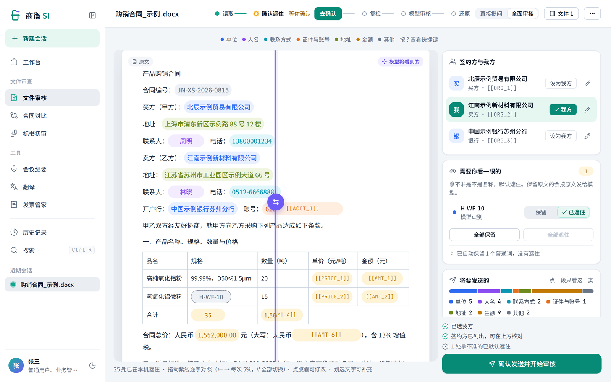

**左边是文件**。中间的紫线可以左右拖动：线左边是原文，线右边是“模型将看到的”样子（真实信息已换成代号）。按 V 可以整页切换。被遮住的内容按颜色区分：单位、人名、联系方式、证件与账号、地址、金额、其他。

**右边从上到下**：

| 区块 | 你要做的 |
|-|-|
| 签约方与我方 | 核对列出的签约方；在本公司那一行点“设为我方”（全面审核必须选）。点铅笔可修改国家、类型 |
| 需要你看一眼的 | 系统拿不准的名称、缩写、型号，默认已遮住。确实不敏感的点“保留”，否则保持“已遮住”。可“全部保留”或“全部遮住” |
| 将要发送的 | 本次发送的字数、已遮住的处数和分类；可“查看将发送的全文” |
| 审核设置 | 业务立场（销售 / 采购 / 其他）、文件来源（我方发出 / 对方发来）、审核模型、本次补充说明、查看审核要求 |
| 提交条件 | 列出尚未满足的条件，比如“还没选哪一方是我方” |

**补充遮住**：在左侧原文中选中一段文字，在弹出的浮条中选类别（公司、人名、联系方式、账号、证件号、编号、地址、金额、项目、其他），点“设为敏感信息”，全文相同文字一并遮住。

**撤销误遮**：点某个遮住的胶囊，可选“撤销（不是敏感信息）”。金额不能撤销。

**校对扫描文字**：PDF 扫描件识别错字时，点选该段文字，选“校对识别文字”，对照右侧原件放大图修改后保存。

**快捷键**（按 ? 查看）：V 切换原文 / 模型视野；J / K 下一个 / 上一个拿不准的项；B 保留原文；T 遮住；[ ] 切换文件；Ctrl+Enter 定位到确认按钮；Esc 关闭弹层。

确认无误后点 **“确认发送并开始审核”**。系统会在本机再做一次出口复检，发现漏遮的真实信息会拦下并在右栏列出，处理后再提交。你确认替换的名称会被记住，下次自动遮住；你保留的普通词也会被记住，下次自动保留（8 秒内可撤销）。

> 如果不想让文件内容发往云端，可以在审核设置中选“不外发，仅本地校验”：系统只做金额、日期等本机检查，不调用模型。

### 3.3 审核中

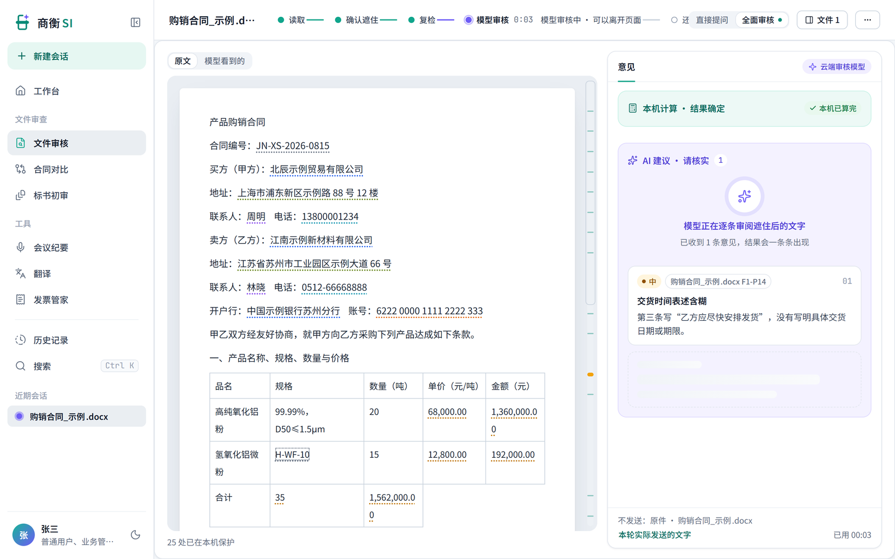

审核按表述、逻辑、法律、合规与制裁、商务分组同时进行，问题边审边出。常规合同几分钟完成。你可以离开页面做别的事，完成后侧栏会话显示“审核完成”。

### 3.4 查看结果

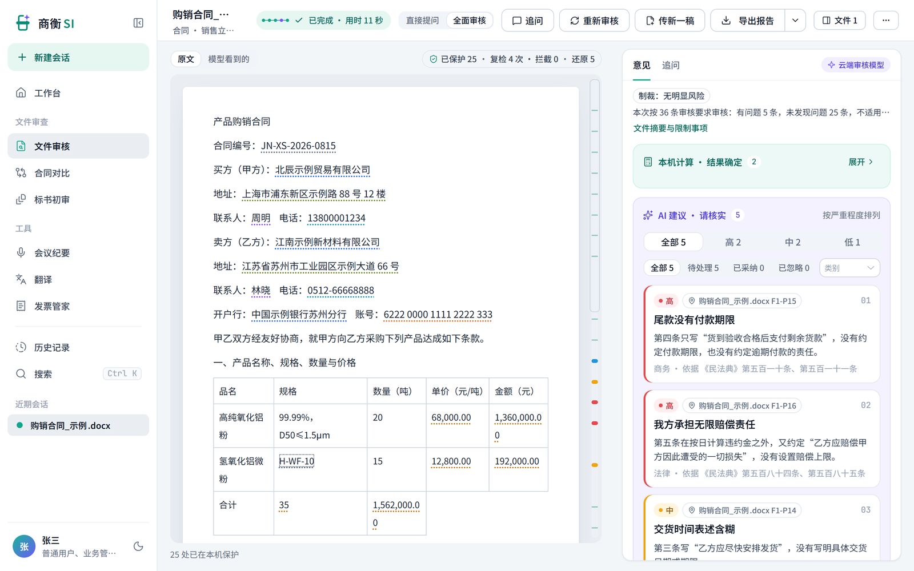

**顶部工具条**：追问、重新审核、传新一稿、导出报告、文件。

**左边原文**：问题所在位置有彩色下划线和“问题 nn”标记，点标记跳到对应意见。可切换“原文 / 模型看到的”。纸面上方的回执“已保护 · 复检 · 拦截 · 还原”点开可以查看本轮实际发给模型的全部文字。

**右边意见栏**：

| 区块 | 内容 |
|-|-|
| 摘要 | 制裁结论（注明未联网核查）、按审核要求的统计、文件摘要与限制事项 |
| 本机计算 · 结果确定 | 本机核对出的金额、合计、税额、大小写、日期、跨文件不一致等问题，结论确定，点“展开”查看 |
| AI 建议 · 请核实 | 模型提出的问题，按高、中、低排序；可按等级、处理状态、类别筛选 |

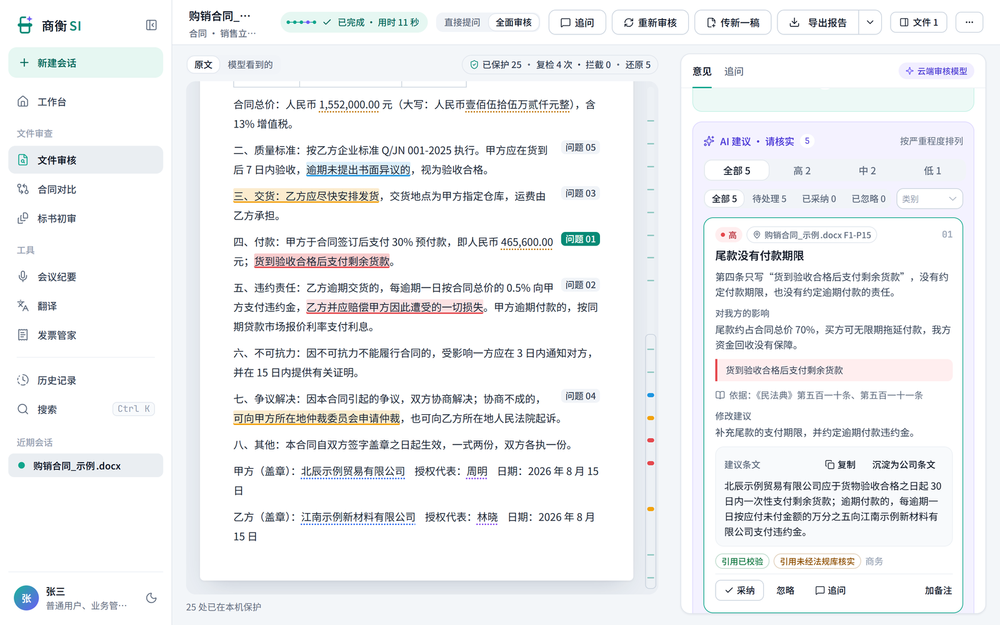

点一条问题展开，可以看到：问题说明、对我方的影响、引用的原文、依据、修改建议和**建议条文**（已换回真实名称）。标签“引用已校验”表示引用的原文在文件中能找到。

| 操作 | 说明 |
|-|-|
| 复制 | 复制建议条文 |
| 采纳 / 忽略 | 标记处理状态；处理后自动跳到下一条待处理问题。快捷键 A 采纳、I 忽略、↑↓ 切换 |
| 追问 | 就这条问题继续讨论（见 3.5） |
| 加备注 | 给自己记一句，会写进报告 |
| 沉淀为公司条文 | 把好的建议条文共享给公司同事参考（需对应权限） |

文中出现标黄的文字，表示模型写了文件中没有的代号，系统无法还原，请对照原文核实。

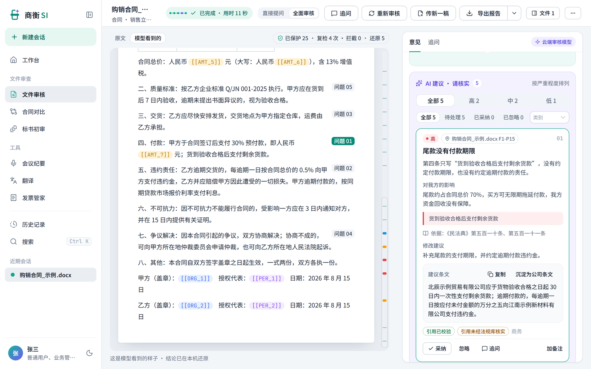

### 3.5 追问与讨论

- **追问整份文件**：点工具条“追问”或意见栏的“追问”页签，输入问题后发送。
- **讨论某条问题**：在问题卡上点“追问”，右栏换成这条问题的讨论，可以让模型改写条文。回复中的【修改条文】可以“保存到该问题的修改建议”，并选择导出时使用原建议还是讨论稿。
- 你的提问同样先遮住再发送。消息里如有疑似敏感信息，会弹窗请你逐项选择“替换”或“保留”。每条提问下有“查看实际发送内容”。
- 回复中以【算式】开头的计算由本机完成，结果不发给模型。

### 3.6 重新审核与新一稿

| 操作 | 什么时候用 |
|-|-|
| 重新审核 | 改了立场、来源、补充说明，或想换个模型再审。旧结果保留，可切换轮次对照 |
| 传新一稿 | 对方改稿后上传新版本。系统在本机比对两稿，可选择“只审变化”或“全文重审”，并标出上轮问题哪些已解决 |

### 3.7 导出

点“导出报告”或旁边的下拉箭头选择：

| 导出 | 内容 |
|-|-|
| 审核报告（Word） | 基本信息、覆盖说明、结论摘要、问题清单、本地校验、审核要求逐条结论 |
| 问题清单（Word） | 横向表格：原页码与条款、问题与依据、建议条文 |
| 批注版（Word） | 意见以批注形式挂在原文副本上，原文一字不改；只对 Word 文件提供 |
| 变化对照表 | 有上一稿时，列出两稿差异 |

导出使用真实名称。**批注版含内部审核意见，请勿直接发给对方。** 导出文件不在服务器保存，需要时可随时重新导出。

## 4 工作台

工作台是自由对话的地方：可以直接提问，也可以加入文件后提问。

1. 在输入框输入问题，Enter 发送，Shift+Enter 换行；生成过程中可点“停止”。
2. 点“添加文件”或把文件拖进来（每次 1～5 个，一个会话最多 10 个）。新文件需要先确认脱敏，确认后才会被用于回答；输入框上方的文件标签可以点选本次提问使用哪些文件。
3. 首页的快捷标签：

| 快捷标签 | 用途 |
|-|-|
| 全面审核这份合同 | 转到文件审核流程 |
| 起草回复函 | 根据加入的来函起草回复 |
| 核对单证 | 比对发票、装箱单、提单、信用证等单据的品名、数量、金额、日期、单号等是否一致；本机抽取比较，可导出 Word、Excel |
| 比较几份报价 | 对齐几份报价单的项目，价格在本机计算 |

4. 回复可复制、导出 Word；含表格时可导出 Excel。
5. 勾选“附带公司知识库”时，会检索管理员维护的公司资料一并参考（管理员开启后才有此选项）。
6. 同一会话中可以随时切换到“全面审核”，对已加入的文件做完整审核。

录音请到“会议纪要”中处理，工作台不收录音。

## 5 合同对比

用于比较同一份合同的两个版本，全程在本机比对，不调用模型、不留记录。

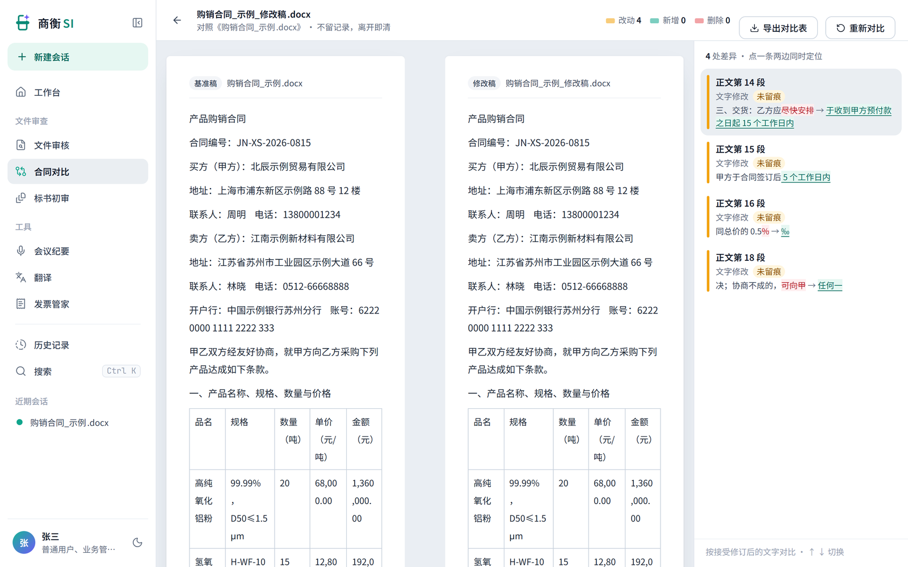

1. 点侧栏“合同对比”。
2. 左边放基准稿（通常是最初版本），右边放修改稿（通常是对方改过的版本）。支持 DOCX 和 DOC。
3. 点“开始对比”。两稿并排显示，右侧列出每处改动、新增、删除，并标明是否留了修订痕迹；点一条差异，两边同时定位。
4. 可“导出对比表”（Word）。离开页面后结果清除。

## 6 标书初审

用于开标时快速找出投标文件中的否决类问题和串标线索。不打分、不排序、不推荐中标人，最终判断由人作出。

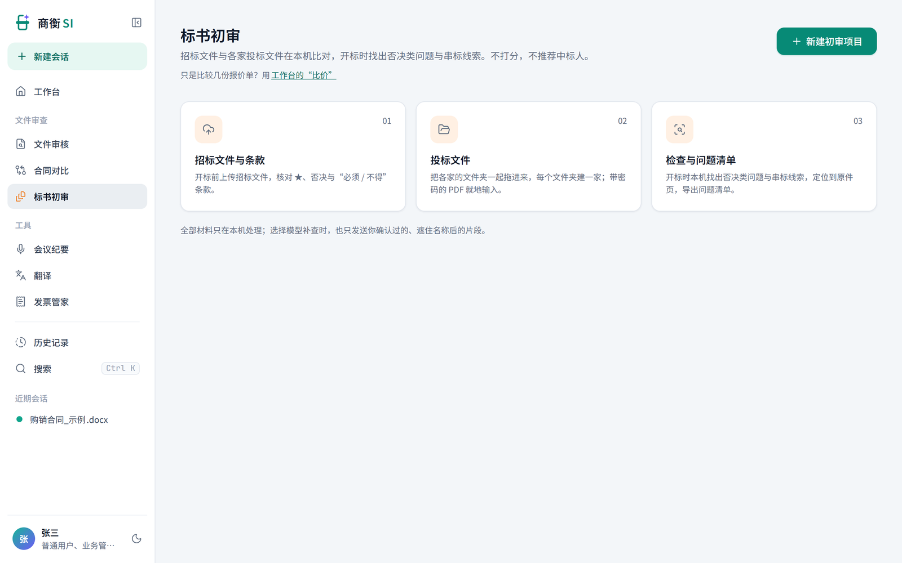

1. **新建项目**：点“新建初审项目”，填写项目名称，选择分类、文件夹和开标日期（用于判断有效期、证书是否过期），并选择外发策略：“只做本地检查”（默认，不调用模型），或“本机检查，可选模型补查”。开始初审后名称、开标日期与外发策略不能再改。
2. **招标文件**：上传招标文件（最多 5 份）。系统本机抽取 ★ 条款、否决条款和“必须 / 不得”要求，可人工修改或补充。
3. **投标文件**：把各家的文件夹一起拖进来，每个文件夹建一家投标人（每个项目最多 20 份文件，单个不超过 100 MB、600 页）。带密码的 PDF 在页面上直接输入密码。
4. **检查**：点开始检查。系统在本机比对，结果分为“严重”和“提示”：
   - ★ / 否决条款不响应（有证据的）；
   - 串标线索：文件属性相同、联系方式相同、相似段落、相同罕见错字、报价尾数规律等，两家并排核对；
   - 报价复算：含税 / 不含税、主辅机组成、异常低价；可在投标人卡中录入或更正唱标价。
5. **模型补查（可选）**：对本机无法判定的 ★ / 否决要求，可选择让模型补查。只发送遮住名称后的相关片段，投标人以代号表示，发送前会显示字数和待发文本供确认。
6. **处理与导出**：点问题可查看原件页及高亮位置；不是问题的点“不是问题”（可撤回）。导出 Word 问题清单，按投标人分节；也可只导出串标线索。

只是比较几份报价单的话，用工作台的“比较几份报价”更方便。

## 7 会议纪要

1. **加入录音**：拖入录音文件（MP3、M4A、WAV、AMR、AAC、MP4，单个不超过 500 MB、3 小时），或点“现场录音”直接用电脑麦克风录（需 https 访问；录音中可暂停、打点、填写主题和参会人；意外关闭页面后可恢复未上传的录音）。
2. **本机转写**：录音在服务器本机转写为逐字稿，1 小时录音约 1 小时内完成，可以离开页面。
3. **校对逐字稿**：点句子可从该处播放；点文字直接修改；点段首的发言人可改名；侧栏填写参会人名单，系统会给出同音字纠正建议。
4. **确认脱敏**：参会人和发言人姓名会被遮住。
5. **生成会议纪要**：选择模型后生成，内容包括会议概况、议题、讨论要点、决议、待办（事项 / 负责人 / 期限）和需确认的事项。只发送遮住名称后的逐字稿，录音和声纹不外发。
6. 逐字稿、纪要都可导出 Word；也可以“在智能助手中就这场会议继续提问”。

录音转写是可选组件，未启用时页面会提示“录音转写未启用”。

## 8 翻译

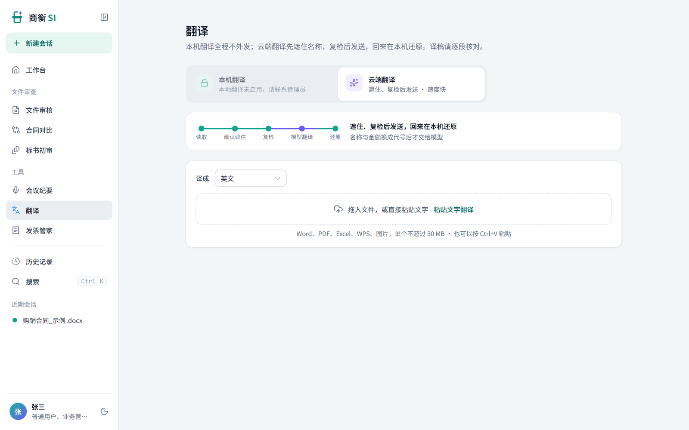

1. 选择翻译方式：
   - **本机翻译**：全程不外发，不需要确认脱敏；速度较慢（万字约 1 小时），可以离开页面，可随时停止并保留已译部分。未启用时显示“本地翻译未启用”。
   - **云端翻译**：先确认脱敏，名称与金额换成代号后发给模型，回来在本机还原；速度快。
2. 选择目标语言（“译成”）。
3. 拖入文件（Word、PDF、Excel、WPS、图片，单个不超过 30 MB），或点“粘贴文字翻译”（不超过 2 万字）。
4. 结果可按“译文 / 对照”查看，导出译文 Word 或双语对照 Word。

**译稿请逐段核对**，尤其是合同条款，不要直接作为签署文本。

## 9 发票管家

把一批发票在本机识别，整理成一份 Excel 清单。不调用模型，不留记录。

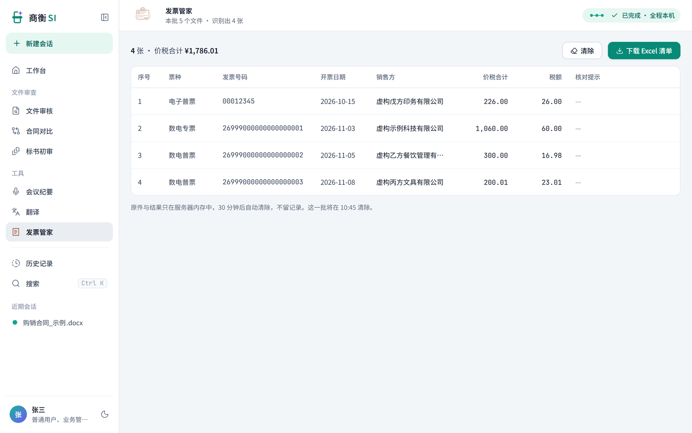

1. 拖入发票或点“选择文件”，也可以 Ctrl+V 粘贴。支持 PDF、OFD、XML、JPG、PNG，可以整包拖入 zip（加密的 zip 不收）。每批最多 100 个文件，单个不超过 20 MB、合计不超过 200 MB。
2. 系统读取发票号码、日期、销售方、价税合计、税额等，并用二维码核对；价税合计不符、大小写不一致、识别置信度低等会在“核对提示”中列出。
3. 点“下载 Excel 清单”。号码按文本保存，金额保留两位，末行为合计，未识别的文件另列一表。
4. 原件与结果只在服务器内存中，30 分钟后自动清除；点“清除”立即清除。

适用于国内数电票、增值税发票和客票。外贸商业发票请用工作台的“核对单证”。

## 10 历史记录

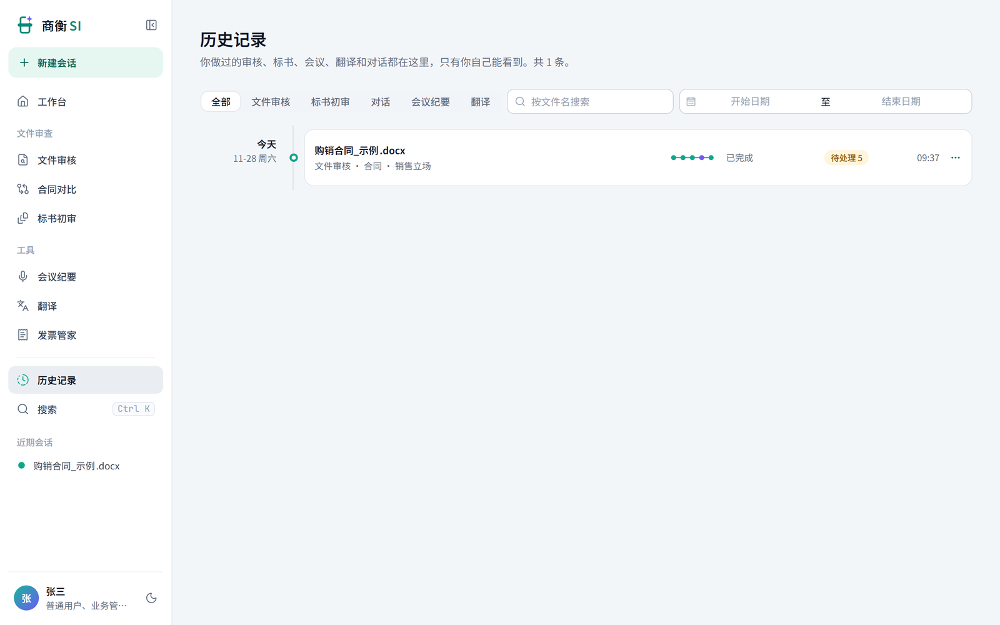

历史记录列出你做过的文件审核、标书初审、对话、会议纪要和翻译，只有你自己能看到。

- 按类型分段、按日期和名称筛选。
- 每行显示名称、状态、问题摘要（如“待处理 5”）、最近活动和保留期限。
- 点一行继续处理；行尾菜单可导出最新一轮报告、删除。

**删除**会彻底删除该任务的原件、结果和对话，无法恢复。到保留期后系统也会自动清理（见 12.3）；原件清理后，结果仍可查看和导出，但不能再重新审核或追问。

## 11 个人设置

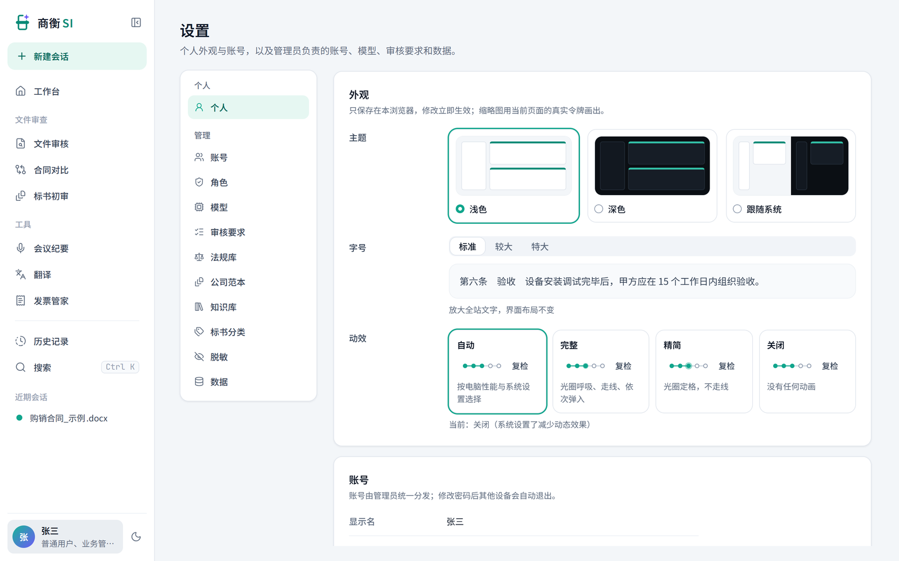

点侧栏底部你的名字 →“设置”，第一个分页是“个人”：

| 设置 | 说明 |
|-|-|
| 外观 | 主题（浅色 / 深色 / 跟随系统）、字号（标准 / 较大 / 特大）、动效（自动 / 完整 / 精简 / 关闭），只保存在本浏览器 |
| 账号 | 显示名、用户名、角色；修改密码（改密后其他设备自动退出） |
| 登录设备 | 列出你在线的浏览器和登录时间，可退出某个设备或退出其他全部设备 |

当你的账号在新的地点登录时，其他在线页面会弹出提醒；如果不是你本人，请点“退出其他设备”并修改密码。

## 12 常见问题

| 问题 | 处理 |
|-|-|
| 浏览器提示“不安全”或证书错误 | 按 2.1 安装根证书；仍不行请联系管理员 |
| 页面提示请改用 Edge | 系统需要较新的浏览器，请用最新版 Edge |
| 忘记密码、账号被锁定 | 等 15 分钟后再试，或请管理员重置密码 |
| 看不到某个菜单 | 菜单按权限显示，请联系管理员开通 |
| 点“确认发送”后提示被拦截 | 出口复检发现了未遮住的真实信息，按右栏拦截清单逐条处理后再提交 |
| 提示“已达本月调用上限”或“今日调用次数已用完” | 联系管理员调整上限，或第二天再试 |
| 扫描件文字识别有错 | 在确认页用“校对识别文字”修改（首次送审前） |
| 结果中有标黄的文字 | 模型写了文件中不存在的代号，系统无法还原，请对照原文核实 |
| 审核失败或部分完成 | 点“重新审核”；多次失败请联系管理员检查模型设置 |
| 原件已按保留期限删除 | 结果仍可查看和导出，不能再重新审核和追问 |
| 想审核但不想让内容出公司 | 选“不外发，仅本地校验”，或用合同对比、发票管家、本机翻译 |

---

# 管理篇

## 13 角色与权限

设置中的管理分页按权限显示。权限分为 19 个权限点，管理员把权限点组合成角色，再把角色分给人；一个人可以有多个角色。

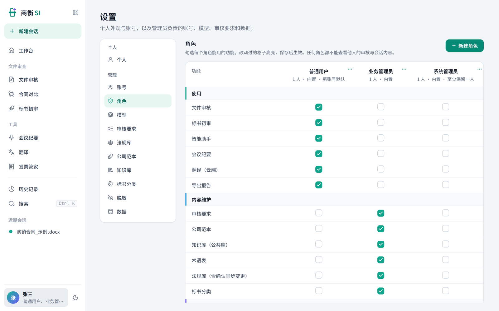

| 权限组 | 权限点 | 对应 |
|-|-|-|
| 使用 | 文件审核、标书初审、智能助手、会议纪要、翻译（云端）、导出报告 | 侧栏菜单与发起操作 |
| 内容维护 | 审核要求、公司范本、知识库（公共库）、术语表、法规库（含确认同步变更）、标书分类 | 设置中的对应分页 |
| 脱敏维护 | 已记住的名称、自定义敏感词与识别设置、我方主体 | 设置 · 脱敏 |
| 系统 | 账号与角色、模型、数据（备份、保留期、系统状态）、法规同步开关 | 设置中的对应分页 |

内置三个角色（可改名、调整权限，不能删除）：

| 角色 | 默认权限 |
|-|-|
| 普通用户 | 使用类中除“标书初审”外的 5 项（新账号默认） |
| 业务管理员 | 内容维护与脱敏维护全部 9 项 |
| 系统管理员 | 系统类 4 项；必须至少保留一个启用账号持有“账号与角色” |

“使用”类权限只限制新建和发往云端的操作，本人已有的内容仍可查看；本机翻译不需要权限。**任何角色都不能查看他人的审核与会话内容**；管理员能看的只有外发记录（脱敏后的文字）。

## 14 业务管理员

### 14.1 审核要求

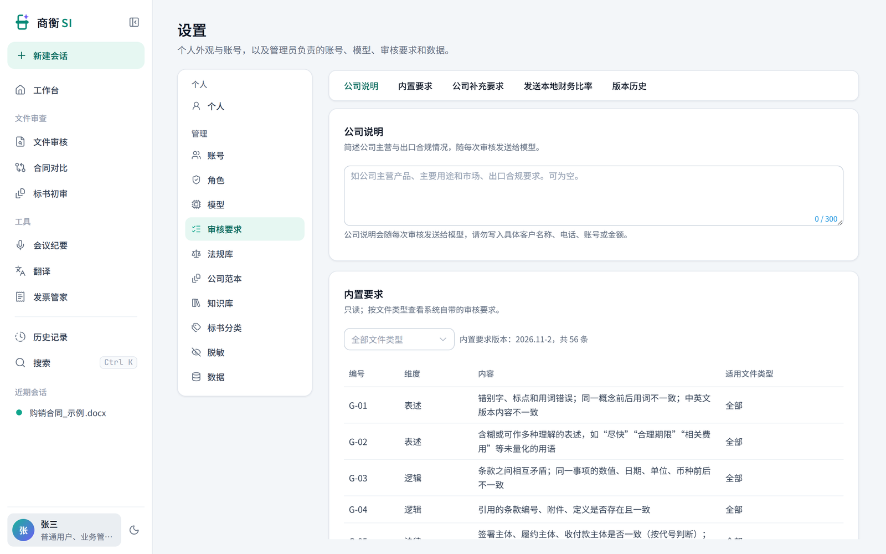

| 分节 | 说明 |
|-|-|
| 公司说明 | 一段不超过 300 字的公司介绍（主营产品、市场、出口合规要求），随每次审核发给模型。**不要写客户名称、电话、账号或金额** |
| 内置要求 | 系统自带的审核要求，只读，可按文件类型查看 |
| 公司补充要求 | 公司自己的审核要点。每条不超过 300 字，可限定文件类型、立场、来源，可启用 / 停用、排序；最多 100 条，同一适用组合内启用的不超过 30 条。补充要求只能增加审核内容，不能取消内置要求 |
| 发送本地财务比率 | 默认关。开启后，识别到财务报表时随审核附带本机算出的财务比率（只有比率，不发金额） |
| 版本历史 | 每次保存公司说明或补充要求都生成新版本，可查看历史内容 |

### 14.2 公司范本

上传本公司的标准合同（DOCX），填写名称、文件类型、立场，并可按条填写标准立场、可接受范围、需上报的情形。审核时系统按文件类型和立场自动选择合适的范本，在本机比对缺失条款，并把脱敏后的范本条款一并发给模型参考。最多 50 份。

“公司沉淀”页签列出员工从审核结果中沉淀的建议条文，可以撤下不合适的内容。

### 14.3 知识库

上传公司制度、流程、产品资料等，供工作台检索参考。默认关闭，打开“在工作台中启用知识库”开关后，员工提问时勾选“附带公司知识库”才会检索。片段经脱敏后随问题发送，含疑似敏感信息的整段不发送。处理失败的资料可在原行重新上传。

### 14.4 法规库

| 分节 | 说明 |
|-|-|
| 自动更新 | 由系统管理员开启（开启时会提示将访问国家法律法规数据库）。可选每月 / 每周、立即同步 |
| 审核时附带相关法条 | 默认关闭。开启后审核与追问会检索相关法条原文一并发给模型，每次审核约多 5 千个 token |
| 导入目录与全文 | 手动导入官方导出的法规目录（XLS / XLSX）与全文压缩包，预览差异后确认生效 |
| 同步时间线 | 每次导入或同步一个节点，**待确认的置顶，确认后才写入法规库** |
| 法规列表 | 按标题、分类、时效性查找；可为已废止的法规填写替代法规 |

### 14.5 标书分类

新建标书初审项目时必选的分类，全公司统一。默认有工程类、采购类、服务类、其他，可添加、改名、启用 / 停用；已有项目使用的分类不能删除，只能停用。

### 14.6 脱敏

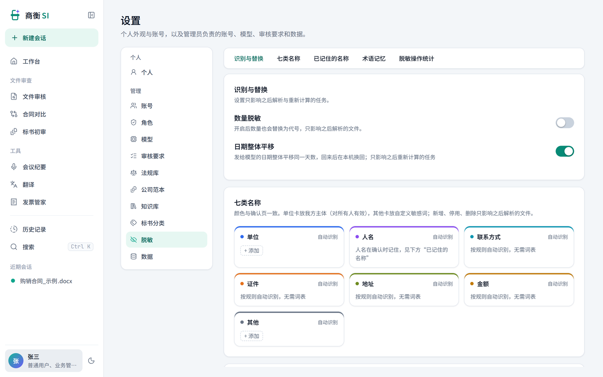

| 分节 | 说明 |
|-|-|
| 识别与替换 | 数量脱敏（默认关，开启后数量也换成代号）；日期整体平移（默认开，发给模型的日期统一平移，回来后还原）。只影响之后解析或重新计算的任务 |
| 七类名称 | 单位卡中添加**我方主体**（本公司及子公司名称，所有人确认页自动预选为我方）；其他卡中添加**自定义敏感词**（如项目代号、产品代号），可停用、删除 |
| 已记住的名称 | 员工在确认页确认过的公司名、人名，以后自动遮住。可搜索、删除 |
| 术语记忆 | 员工在确认页选择保留原文的普通词。可认可为公司共享，或删除 |
| 脱敏操作统计 | 近 7 / 30 / 90 / 365 天确认页的操作情况与“无法判断”统计，只有数字 |

已记住的名称或自定义敏感词如果出现在公司说明、补充要求等审核提示文字中，管理员会收到提醒，请修改提示文字。

## 15 系统管理员

### 15.1 账号

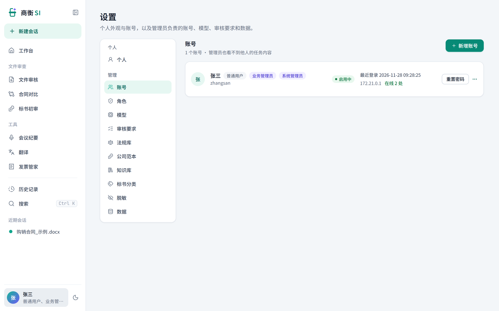

| 操作 | 说明 |
|-|-|
| 新增账号 | 填写用户名、显示名、初始密码，勾选角色。员工首次登录须修改密码 |
| 修改角色 | 勾选或取消角色 |
| 重置密码 | 设置新的初始密码，员工下次登录须修改 |
| 停用 / 启用 | 停用后立即下线、不能登录。有历史数据的账号只能停用，不能删除 |
| 强制下线 | 退出此人所有在线会话 |

列表显示每个账号的最近登录时间与 IP、在线处数。

### 15.2 角色

在角色分页中新建角色、勾选权限点；改动过的格子高亮，保存后生效。在用的自定义角色不能删除。

### 15.3 模型

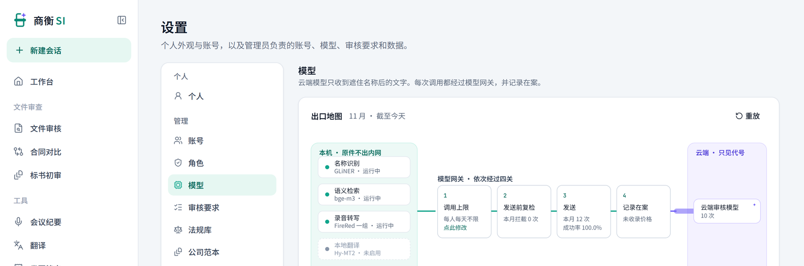

| 区块 | 说明 |
|-|-|
| 出口地图 | 本月的本机组件状态、模型网关四关（调用上限、发送前复检、发送、记录在案）的计数，以及各云端模型的调用量 |
| 值班席位 | 审核默认模型、助手默认模型，可“更换” |
| 已接入 | 各模型卡片：调用次数、费用、余额与对账结论；可编辑、测试连接、设为默认、停用、删除 |
| 添加模型 | 预置 DeepSeek、智谱 GLM、Kimi、通义千问四张卡片，只需填写 API 密钥，点“测试并启用”；也可“自定义模型” |

注意：

- **每增加一个模型，就是一个新的外发目的地**，接口地址须在公司网络出口放行（卡片上会提示域名）。
- 保存前系统自动测试连接和结构化输出，结构化输出测试通过的模型才能用于文件审核。
- 可设置每个模型的每月调用上限、每人每日调用上限（0 为不限）。
- 费用按内置价格表计算；DeepSeek、Kimi 会每小时对账余额，相差较多时卡片提示“价格表可能已过期”。
- 只做过测试的模型可以删除；用过的模型只能停用。默认模型不能停用，先更换默认。
- 模型参数（温度、最大输出、超时、分段长度、附加请求参数等）的推荐值见《运维说明》第 4 章。

### 15.4 数据

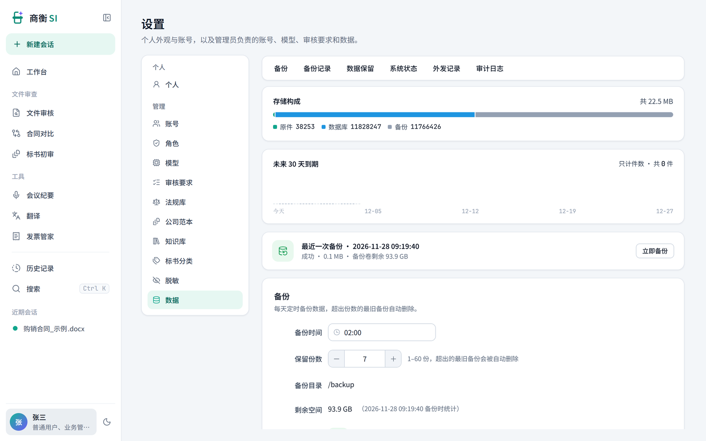

| 分节 | 说明 |
|-|-|
| 存储构成 | 原件、数据库、备份占用；未来 30 天到期的件数 |
| 备份 | 每天定时备份（默认 02:00）、保留份数（默认 7，1～60）、立即备份；显示最近一次结果与备份盘剩余空间 |
| 备份记录 | 最近 20 次备份结果 |
| 数据保留 | 原件与原文、审核结果与对话、外发记录正文、审计日志、未完成任务，分别选 30 / 90 / 180 / 365 天或永久。缩短保留期需二次确认 |
| 系统状态 | 版本号、排队任务数、磁盘剩余、各存储占用与预计可用天数、本地模型校验与启用状态 |
| 外发记录 | 每次模型调用的时间、用户、用途、模型、字数、状态，可按用户、日期、状态筛选，点开查看发出与返回的全文（均为脱敏后的内容） |
| 审计日志 | 登录、设置修改、账号变更、导出、备份等操作记录 |

**备份只存在服务器的数据盘上，异地备份必须由运维另行完成**（见《运维说明》第 9 章）。恢复数据不在界面中操作，由运维用恢复脚本完成。

### 15.5 法规同步开关

在法规库分页顶部开启“自动更新”。开启时会弹窗说明系统将访问国家法律法规数据库的两个公开域名；同步只下载公开法规，请求中不含任何业务数据。同步结果需要业务管理员确认后才生效。

### 15.6 管理员提醒

有需要处理的事项时，侧栏底部会出现“提醒 n”，点开逐条查看并“去处理”：

| 提醒 | 收到的人 |
|-|-|
| 最近一次备份失败；备份空间不足 | 数据权限 |
| 本月调用次数达到上限的 90% | 数据权限 |
| 法规自动更新失败 | 法规同步权限 |
| 法规库有更新待确认 | 法规库权限 |
| 敏感名称出现在审核提示文字中 | 内容维护与脱敏维护权限 |

“本次收起”只在当前页面有效，刷新或重新登录后仍会显示，直到问题解决。

---

## 附录 A 支持的文件与上限

| 功能 | 格式 | 上限 |
|-|-|-|
| 文件审核 | DOCX、DOC、WPS、RTF、PDF、XLSX、XLS、ET、JPG、PNG | 每次 10 个，单个 30 MB；PDF 200 页；每次文字识别 100 页 |
| 工作台 | 同上 | 每次 1～5 个，一个会话 10 个；每条消息 4000 字 |
| 合同对比 | DOCX、DOC | 两份 |
| 标书初审 | 招标文件、投标文件（PDF、Word 等） | 招标 5 份、投标 20 份；单个 100 MB、600 页；每项目文字识别 500 页 |
| 会议纪要 | MP3、M4A、WAV、AMR、AAC、MP4 | 单个 500 MB、3 小时 |
| 翻译 | Word、PDF、Excel、WPS、图片；粘贴文字 | 单个 30 MB；粘贴 2 万字 |
| 发票管家 | PDF、OFD、XML、JPG、PNG、ZIP | 每批 100 个，单个 20 MB，合计 200 MB |

宏文件（如 DOCM、XLSM）和加密的 Office 文件不能上传。

## 附录 B 名词

| 名词 | 含义 |
|-|-|
| 遮住 / 脱敏 | 把真实信息换成代号，如把公司名换成 `[[ORG_1]]` |
| 代号 | 替换真实信息的符号；同一对象在同一任务中代号不变 |
| 还原 | 把模型回复中的代号换回真实名称，只在本机进行 |
| 出口复检 | 发送前对全部文字再检查一遍，发现漏遮就拦下 |
| 拿不准的项 | 系统不能确定是否敏感的内容，默认遮住，由你决定 |
| 本机计算 | 系统按规则算出的结果，确定无误，不经模型 |
| 轮次 | 对同一份文件的一次审核；重新审核会产生新轮次 |
| 立场 / 来源 | 销售、采购或其他；我方发出或对方发来 |
