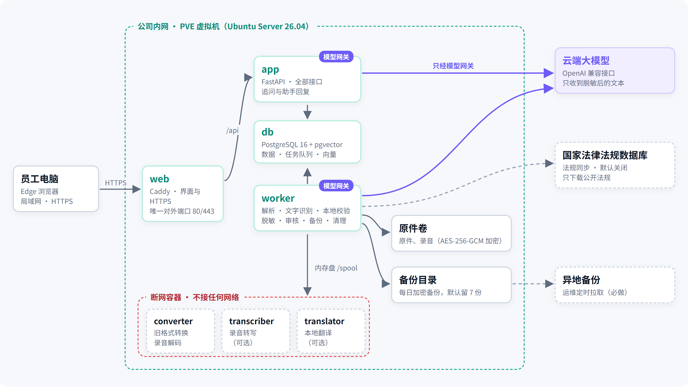
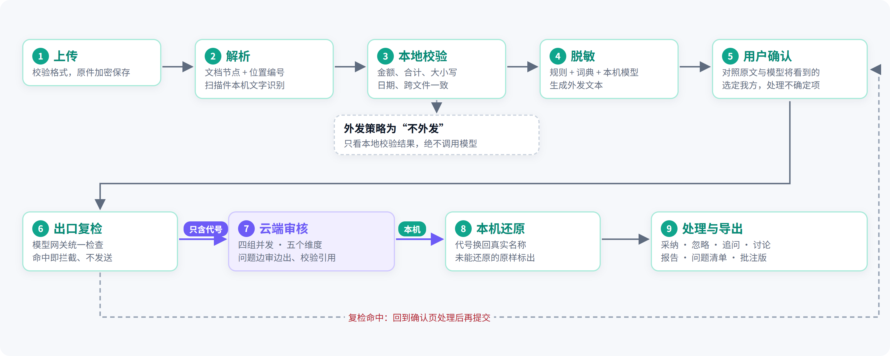
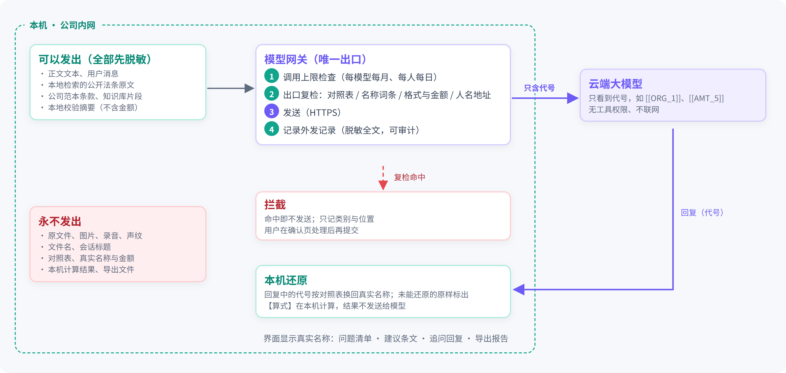

# 商衡SI 系统架构说明书

| 项目 | 内容 |
|-|-|
| 产品 | 商衡SI · 企业安全脱敏与智能审查平台 |
| 适用版本 | V3.6.2（代码基线：标签 `v3.6.2`） |
| 读者 | 信息技术、信息安全、管理层；后续维护人员 |
| 日期 | 2026-11-28 |
| 配套文件 | 《系统使用说明书》《运维说明》；字段与阈值细节以 docs/SPEC.md 为准 |

本文说明系统由什么组成、数据怎样流动、安全怎样保证。不写服务器地址、端口以外的部署参数和密钥位置，可以转给公司外部的审查方。具体操作步骤见《运维说明》。

## 1 系统概述

### 1.1 定位

商衡SI 是在公司局域网内使用的商务文件初审工具。用户上传对外商务文件，系统在本机解析、校验并自动脱敏，用户确认后才交给云端大模型初审；结果回到本机后还原成真实名称，以问题清单的形式展示，可以追问，也可以导出 Word 报告。

公司内没有部署大模型的条件，审核依赖国内厂商的云端大模型接口。因此**脱敏是系统的核心**：原件、真实名称和金额只留在公司内网，发出去的只有脱敏后的文本。

### 1.2 设计原则

| 原则 | 含义 |
|-|-|
| 脱敏优先 | 任何发给模型的文字都要先在本机脱敏、经用户确认，发送前再统一复检 |
| 三层分工 | 确定性规则与计算优先，其次本机 CPU 小模型，最后才是只见脱敏文本的云端模型 |
| 无 GPU 可用 | 主线功能在 10 vCPU、15 GiB 内存、无 GPU 的虚拟机上可用；录音转写与本地翻译为可选组件 |
| 原件不改 | 原件加密保存、永不修改；报告、批注版等导出在内存中生成新文件，服务器不留存 |
| 本人可见 | 任务与会话只对本人可见，管理员也不能查看他人内容 |
| 零维护可用 | 法规库、公司范本、知识库按需维护，不维护不影响基本审核 |

### 1.3 功能一览

| 功能 | 做什么 | 是否调用云端模型 | 权限点 |
|-|-|-|-|
| 工作台 | 自由提问；摘要、起草回函、单证核对、比价四个快捷模板；按问题讨论 | 是，脱敏后 | use.assistant |
| 文件审核 | 合同、报价单、订单、询价函、函件按五个维度初审；多稿增量复审 | 是，脱敏后；可选“不外发” | use.review |
| 合同对比 | 两稿逐区比对，标出改动与修订留痕，导出变化对照表 | 否 | use.review |
| 标书初审 | 开标前查★条款与否决项、串标线索、报价复算 | 本机为主；可选模型补查 | use.bid |
| 会议纪要 | 录音本机转写、校对，生成纪要 | 仅生成纪要时，发脱敏后的逐字稿 | use.meeting |
| 翻译 | 本地翻译（不外发）或脱敏后云端翻译 | 仅选云端时 | 云端需 use.translate |
| 发票管家 | 本机识别国内发票，导出 Excel | 否 | use.export |
| 历史记录、全局搜索 | 本人的审核、标书、会议、翻译与对话 | 否 | — |
| 设置 | 个人设置；管理分页按权限点显示 | 否（测试模型连接除外） | 见 5.5 |

审核维度：表述、逻辑、法律、合规与制裁、商务。合规与制裁的目标是防止公司因某笔交易或某份文件被制裁或处罚；系统不联网，制裁结论固定注明“未联网核查”。

## 2 部署架构

### 2.1 运行环境

| 项目 | 配置 |
|-|-|
| 宿主 | Proxmox VE（PVE）中的一台虚拟机；升级、恢复前用 PVE 快照作回退点 |
| 操作系统 | Ubuntu Server 26.04 LTS，x86_64，固定内网 IP |
| 规格 | 只运行主线：10 vCPU、15 GiB；启用录音转写与本地翻译：28 vCPU、38 GiB |
| 磁盘 | 系统盘 32 GiB；数据盘 344 GiB 挂在 /data，业务数据、Docker 数据、备份全部在 /data |
| 容器 | Docker Engine 29 + Docker Compose v2，由信息技术部门安装 |
| 客户端 | Windows 10 / 11 上的最新版 Edge（同内核 Chrome 亦可），桌面端，最小宽度 1280 像素 |
| 访问方式 | 局域网内用服务器 IP 访问，HTTPS，证书由系统自建的签发机构提供（7.5） |

### 2.2 容器

系统是一个模块化单体应用，全部容器运行在同一台虚拟机里。

| 容器 | 镜像 | 职责 | 网络 |
|-|-|-|-|
| web | Caddy 2 + 前端构建产物 | 提供界面、HTTPS，把 /api 转发到 app；80 跳转 443 | 唯一发布端口（80、443） |
| app | backend | 全部接口、追问与智能助手的流式回复；启动时执行数据库迁移 | 内部网络；模型调用只经网关 |
| worker | backend（同一镜像） | 解析、文字识别、本地校验、脱敏、审核、备份、定时清理、法规同步 | 内部网络；模型调用只经网关 |
| db | PostgreSQL 16 + pgvector | 唯一的数据存储，同时承担任务队列与向量检索 | 内部网络，不发布端口 |
| converter | LibreOffice + ffmpeg | 旧格式转换（DOC/WPS/RTF→DOCX、XLS/ET→XLSX）、录音解码 | **不接任何网络** |
| transcriber（可选） | 转写一组本地模型 | 录音转写、标点、说话人分离 | **不接任何网络** |
| translator（可选） | llama.cpp + 本地翻译模型 | 本地翻译 | **不接任何网络** |

converter、transcriber、translator 以非 root 用户、只读根文件系统运行，去掉全部系统权限，不挂原件卷、主密钥和数据库，只通过内存盘与 worker 交换文件。所有容器开机自动启动，异常退出自动重启。

### 2.3 存储

| 存储 | 位置 | 内容 |
|-|-|-|
| 数据库卷 | /data 下的 Docker 卷 | 全部业务数据、任务队列、向量 |
| 原件卷 | /data 下的 Docker 卷，app 与 worker 共享 | 加密的原件、旧格式转换结果、录音 |
| 转换内存盘 | tmpfs 2 GiB | worker 与断网容器交换待转换、待转写、待翻译的文件，不落盘 |
| 发票内存盘 | tmpfs 1 GiB | 发票管家的加密原件与识别结果，不进备份，用完即清 |
| 备份目录 | /data/apps/aireview/backup | 每日加密备份；异地备份由运维另行拉取 |

## 3 功能与模块架构

### 3.1 前端

Vue 3 + TypeScript 单页应用，组件库 Element Plus，图标 Lucide，字体与图标随前端打包，不访问外部网站。主要页面：

| 页面 | 地址 |
|-|-|
| 登录 | /login |
| 工作台（智能助手） | /assistant、/assistant/{会话} |
| 文件审核首页 | /review（审核在工作台会话的审核视图中进行） |
| 合同对比 | /compare |
| 标书初审 | /bid、/bid/{项目} |
| 会议纪要 | /meeting、/meeting/{会话} |
| 翻译 | /translate、/translate/{会话} |
| 发票管家 | /invoice |
| 历史记录 | /history |
| 设置 | /settings/{分页}：个人、账号、角色、模型、审核要求、法规库、公司范本、知识库、标书分类、脱敏、数据 |

界面视觉为“澄明二版 · 衡线”：衡青表示本机处理，灵紫表示云端模型，进度用“往返线”从本机走到模型再回到本机。

### 3.2 后端模块

后端为 Python 3.12 + FastAPI，按模块划分：

| 模块 | 职责 |
|-|-|
| auth、security | 登录、会话、CSRF、密码哈希、加密、权限点校验 |
| tasks、assistant、chat | 审核任务、工作台会话（含会议、翻译）、追问对话 |
| parsing | DOCX、XLSX、PDF、图片解析，文字识别，旧格式转换，录音入口，文件类型识别 |
| redaction | 脱敏识别、代号分配、外发文本构建、出口复检、还原 |
| checks、calc | 本地校验（L-01～L-21）、代号算式的本机计算 |
| review | 审核要求、提示词、输出校验、覆盖说明、多稿对比 |
| llm | **模型网关（唯一的模型出网点）**、用量与计价、余额对账 |
| laws、lawsync | 法规库、导入与检索；法规同步（第二个可访问外网的模块） |
| standards、kb、embedding | 公司范本、知识库、向量模型 |
| bid | 标书初审 |
| invoice | 发票管家 |
| export | Word 报告、批注版、问题清单、变化对照表 |
| admin、audit、backup | 设置、外发记录、系统状态；审计日志；备份与保留期清理 |
| worker | 后台任务循环与定时任务 |

模块之间只通过数据库中的数据和明确的函数接口交互。内置审核要求、提示词模板、词表、价格表都是随版本发布的资源文件，不存数据库。

### 3.3 后台任务

后台任务存放在 PostgreSQL 的任务表中，worker 用 `SELECT … FOR UPDATE SKIP LOCKED` 领取；入队后用数据库通知即时唤醒，另有 30 秒轮询兜底。不使用 Redis、Celery 等外部队列。

| 任务组 | 默认并发 |
|-|-|
| 审核 | 8 |
| 解析（文字识别同时 1 个） | 2 |
| 录音转写 | 1 |
| 维护（备份、清理、法规同步、向量化） | 1 |

worker 异常退出后，超过 15 分钟没有心跳的任务重新排队，最多尝试 3 次。

## 4 核心处理流程

### 4.1 文件审核主流程

1. **上传**：拖入、点选或粘贴文件。系统按扩展名和文件头双重校验，原件以主密钥加密后保存。
2. **解析**：每个文件解析为统一的文档节点（段落、表格单元格、工作表单元格、文字识别块），每个节点有唯一位置编号，用于原文定位。
3. **本地校验**：金额、合计、税额、大小写、日期、跨文件一致性等确定性检查（4.3）。
4. **脱敏**：识别签约方与敏感信息，替换为代号，生成待发送的外发文本（4.4）。
5. **确认**：用户在确认页对照原文与“模型将看到的”文本，选定我方，处理拿不准的项。
6. **出口复检与发送**：后端重新生成外发文本，经模型网关复检后发送（5.3）。
7. **审核**：按维度分组并发请求，问题边审边出；输出经结构与引用校验（4.5）。
8. **还原**：回复中的代号在本机还原为真实名称，未能还原的原样标出。
9. **处理与导出**：采纳、忽略、追问、按问题讨论，导出报告、问题清单或批注版。

外发策略为“不外发”的任务只做第 1～3 步，绝不调用模型。

### 4.2 解析

| 格式 | 处理 |
|-|-|
| DOCX | 读取正文、表格、自动编号、修订（按接受修订后的文本审核）、隐藏文字 |
| XLSX | 读取各工作表的单元格与公式；隐藏工作表不参与审核并提示 |
| PDF 文字版 | 读取文字层、坐标和表格 |
| PDF 扫描件、JPG、PNG | 本机文字识别（RapidOCR），扫描页线框表格识别；确认页可人工校对识别文字 |
| DOC、WPS、RTF、XLS、ET | 在断网的 converter 容器中转换为 DOCX / XLSX 后解析 |
| 录音 | 只在会议纪要中；converter 解码，transcriber 本机转写为逐字稿 |

上传限制：每个任务最多 10 个文件，单个不超过 30 MB；PDF 不超过 200 页，每个任务文字识别不超过 100 页。宏文件、加密的 Office 文件直接拒收。

### 4.3 本地校验

本地校验由确定性规则完成，结果确定、不需要模型，计算结果永不外发。

| 类别 | 校验项 |
|-|-|
| 表格与金额 | 行金额（数量 × 单价）、合计、税额、大小写一致、分期金额、分级合计、财务报表勾稽、公式重算、疑似手填 |
| 合同要素 | 跨文件金额、币种一致、报价有效期、交期与签约日、已调整的旧增值税税率、引用的废止法律、范本缺失条款 |
| 跨文件 | 收款账号、签约方名称、编号与单价数量不一致 |
| 文件风险 | 隐藏文字、疑似写给 AI 的指令（只提示，不删除） |

### 4.4 脱敏

脱敏由规则、词典和本机实体识别模型完成，不使用大模型。原则是“把是谁、多少钱藏起来，把怎么约定的留下来”。

**识别顺序**：已记住的名称与自定义敏感词 → 签约方信息块与简称 → 电话、邮箱、账号、证件号、编号等格式化信息 → 金额与单价 → 人名 → 地址与项目名称 → 本机实体识别模型补充识别 → 拿不准的内容列为“不确定项”。

**替换为代号**：单位、人名、电话、邮箱、网址、地址（保留国家）、账号、SWIFT、证件号、合同号等编号、金额、单价、项目名称、自定义敏感词。同一对象在同一任务中始终使用同一代号（中文名、英文名和简称共用），代号只带角色、国家和企业类型。数量默认保留，可开启数量脱敏；日期默认整体平移。

**保留不替换**：条款文字、国家与港口、贸易术语、币种、百分比、期限、产品名称与规格、HS 编码、仲裁与检验机构等公共机构。

**不确定项**：本机拿不准的名称、缩写、型号默认替换，用户可逐项保留原文；普通词自动保留。用户确认替换的名称记入“已记住的名称”，保留的词记入本人的术语记忆，下次自动处理。

**对照表**：代号与真实值的对应关系用主密钥加密，只在本机用于还原。

### 4.5 云端审核

| 项目 | 做法 |
|-|-|
| 接口 | OpenAI 兼容的 Chat Completions；可配置多个模型（最多 10 个），审核、助手可各用默认模型 |
| 发送内容 | 系统提示词、审核背景、主体说明（只有角色、国家、类型）、脱敏后正文、本地校验摘要、审核要求；开启时附本地检索的公开法条与脱敏后的范本条款 |
| 并发 | 审核要求分四组（表述与逻辑、法律、合规与制裁、商务及补充）同时请求，每组看同一份全文 |
| 分段 | 外发正文超过分段长度（默认 6 万字）时按条款边界切分 |
| 流式 | 问题边审边出，作为临时问题逐条显示，整轮结束后合并去重 |
| 校验 | 输出须为约定结构；引用须能在原文中找到（“引用已校验”）；法条依据与本地法规库核对 |
| 失败 | 调用失败自动重试 2 次（间隔 10 秒、30 秒）；输出不合格纠正重试 1 次；部分失败的轮次标为“部分完成” |
| 上限 | 每个模型的每月调用上限、每人每日调用上限，在发送前检查 |
| 不联网 | 不使用任何联网搜索；模型没有工具权限，输出只作为数据显示 |

审核要求分三层：内置要求（随版本发布）、公司补充要求（业务管理员维护，只能增加不能取消内置要求）、本次补充说明（用户填写，同样脱敏）。

### 4.6 其他功能的处理链

| 功能 | 处理链 | 外发内容 |
|-|-|-|
| 工作台 | 加文件 → 解析 → 确认脱敏 → 提问 → 网关流式发送 → 本机还原；单证核对、比价在本机抽取和计算 | 脱敏后正文、消息、知识库片段（开启时） |
| 合同对比 | 两稿在内存中逐区对齐比对；DOC 在断网容器临时转换；结果与原件都不保存 | 无 |
| 标书初审 | 本机抽取★条款与否决项、比对串标线索、复算报价；可选模型补查本机无法判定的条款 | 补查时只发脱敏后的片段，投标人以代号表示 |
| 会议纪要 | 录音解码 → 本机转写（分段、转写、标点、说话人）→ 校对 → 确认脱敏 → 生成纪要 | 只发脱敏后的逐字稿；录音、声纹永不外发 |
| 翻译 | 本地：解析后按段交断网的 translator；云端：确认脱敏后按段翻译并还原 | 本地无；云端为脱敏后正文 |
| 发票管家 | 读取结构化数据或文字层，扫描件本机识别，二维码核对，导出 Excel | 无 |

### 4.7 导出

| 导出 | 内容 |
|-|-|
| 审核报告（Word） | 基本信息、覆盖说明与限制事项、结论摘要、问题清单、本地校验结果、审核要求逐条结论、固定声明 |
| 问题清单（Word 横向） | 按风险等级分组：原页码与条款、问题与依据、建议条文 |
| 批注版（Word） | 问题以批注挂在原文副本上；生成后逐字核对正文与原件一致，否则不输出 |
| 变化对照表（Word） | 多稿或合同对比的改动清单 |
| 回复、单证核对、纪要、译文 | Word；含表格的另可导出 Excel |

全部导出只在服务器内存中生成，不落盘、不保存；模型从不接收或产出文件。

## 5 数据安全设计

### 5.1 外网出口只有两处

| 出口 | 访问对象 | 约束 |
|-|-|-|
| 模型网关 | 设置中配置的模型接口地址 | 依次执行：调用上限检查 → 出口复检 → 发送 → 记录外发记录；任何模型调用（含测试连接、流式回复、余额查询）都不能绕过 |
| 法规同步 | 国家法律法规数据库的两个固定域名 | 默认关闭；只下载公开的法规目录与全文，请求中不含任何任务数据；同步结果经业务管理员确认才生效 |

其他代码不得访问外网，自动化测试中有一条检查专门验证这一点。每增加一个模型就是一个新的外发目的地，须在公司网络出口放行；网络层的出站限制可由信息技术部门另行配置。

### 5.2 外发内容范围

| 会发出 | 永不发出 |
|-|-|
| 脱敏后的正文文本与用户消息 | 原文件、图片、录音、声纹 |
| 本地检索到的公开法条原文 | 文件名、会话标题 |
| 经脱敏的公司范本条款、知识库片段 | 对照表、真实名称、金额 |
| 本地校验摘要（不含金额）；开启时的本地财务比率（只有比率） | 本机计算结果、审核报告等导出文件 |

### 5.3 出口复检

模型网关在每次发送前，对请求中的全部文字统一检查，命中即拦截、不发送：

1. 不可见的标签字符；
2. 本任务对照表中的全部真实值、已记住的名称、自定义敏感词（原文与归一化文本各比对一次，覆盖全角、形近字、繁简体等变体）；
3. 电话、邮箱、网址、账号、证件号、编号、金额等格式化信息重扫；
4. 标签后的人名与地址重扫。

拦截只记录类别与位置，不记录真实值。确认页会列出拦截原因与位置，用户处理后再提交。

### 5.4 加密存储

主密钥（32 字节）在部署时生成，只读挂载给 app 和 worker，不进镜像、不存数据库、不写日志。以 AES-256-GCM 加密：原件与转换结果、录音与回放副本、对照表、文档节点原文、补充说明、问题的引用快照、本地校验详情、已记住的名称与自定义敏感词、模型 API 密钥、公司范本与知识库内容、标书条款参数等。主密钥可停机更换，全部加密字段与原件重新加密。

### 5.5 账号、会话与权限

| 项目 | 做法 |
|-|-|
| 账号 | 管理员统一开通，不提供注册与找回密码；密码至少 8 位、含字母和数字，argon2id 哈希 |
| 登录保护 | 连续 5 次密码错误锁定 15 分钟；首次登录与重置后强制改密 |
| 会话 | 随机令牌存于 HttpOnly、Secure、SameSite 的 Cookie，数据库只存其哈希；空闲 8 小时过期；修改类请求校验 CSRF 令牌；新 IP 登录时提醒本人 |
| 数据隔离 | 所有任务相关接口校验归属，非本人一律返回“不存在”；管理员也不能查看他人任务内容 |
| 权限 | 19 个权限点由代码固定，角色可增删改；内置普通用户、业务管理员、系统管理员三个角色，一人可兼多个角色 |

| 权限组 | 权限点 |
|-|-|
| 使用 | 文件审核、标书初审、智能助手、会议纪要、翻译（云端）、导出报告 |
| 内容维护 | 审核要求、公司范本、知识库、术语表、法规库（含确认同步变更）、标书分类 |
| 脱敏维护 | 已记住的名称、自定义敏感词与识别设置、我方主体 |
| 系统 | 账号与角色、模型、数据（备份、保留期、系统状态）、法规同步开关 |

### 5.6 其他防护

| 项目 | 做法 |
|-|-|
| 提示词注入 | 文件放在专用标签内并转义；提示词声明文件内容不得执行；隐藏文字与疑似写给 AI 的指令在本地提示；模型无工具权限，输出以纯文本显示 |
| 上传检查 | 扩展名与文件头双重校验；拒绝宏文件与加密 Office 文件；解压大小上限防压缩炸弹；文件以随机编号命名存储 |
| 日志 | 应用日志不含原文、真实名称、金额、API 密钥 |
| 审计 | 登录、设置修改、账号变更、任务创建与删除、导出、备份等写审计日志 |
| 外发记录 | 每次模型调用记录时间、用户、用途、模型、字数、状态与脱敏后的收发全文，管理员可查 |
| 删除 | 用户删除任务时彻底删除原件、对照表、结果与对话；外发记录保留脱敏内容供审计，按保留期清除 |

## 6 本地模型与云端模型

### 6.1 本地模型

全部在服务器 CPU 上离线运行，运行时不下载任何模型或依赖；文件随镜像发布并校验 SHA-256，唯一清单为 deploy/models.yaml。

| 用途 | 模型 | 许可 | 运行位置 |
|-|-|-|-|
| 脱敏实体识别 | GLiNER multi v2.1（ONNX） | Apache-2.0 | app、worker |
| 向量检索 | BGE-M3（INT8 ONNX，只用稠密向量） | MIT | app、worker |
| 文字识别 | RapidOCR 3.10 + PP-OCRv6 small | Apache-2.0 | worker |
| 录音转写一组（可选） | FireRedVAD、FireRedASR2-AED、FireRedPunc、pyannote segmentation-3.0、3D-Speaker CAM++ | Apache-2.0 / MIT | transcriber（断网） |
| 本地翻译（可选） | Hy-MT2-7B Q6_K（llama.cpp） | Apache-2.0 | translator（断网） |

本地翻译的译稿须人工逐段核对，不作为可直接签署的合同成品。更换或新增本地模型须经选型评测和产品负责人确认。

### 6.2 云端模型

| 项目 | 做法 |
|-|-|
| 厂商 | 预置 DeepSeek、智谱 GLM、Kimi、通义千问四家，只需填 API 密钥；也可自定义 OpenAI 兼容接口 |
| 启用条件 | 保存前自动测试连接与结构化输出，通过结构化测试才能用于文件审核 |
| 计费统计 | 按内置价格表计算每次调用费用；DeepSeek、Kimi 每小时对账余额，偏差较大时提示价格表可能过期 |
| 用量控制 | 每个模型每月调用上限；每人每日调用上限 |

### 6.3 法规库

法规库存放公开法条原文（不加密），用于审核时附带相关法条与核实模型引用的依据。来源为手动导入，或开启后从国家法律法规数据库同步，变更须确认后生效。

## 7 数据存储与运行维护

### 7.1 数据库

PostgreSQL 16 是唯一的数据存储，同时承担任务队列；向量检索用 pgvector 扩展（HNSW 索引、余弦距离），不另设向量数据库。数据库结构只通过迁移脚本变更，app 启动时自动执行。时间以 UTC 存储，界面按北京时间显示；金额一律十进制精确计算。

### 7.2 数据保留

| 层次 | 内容 | 新安装默认 |
|-|-|-|
| 原件与原文 | 原件、文档节点原文、补充说明、录音 | 30 天 |
| 审核结果与对话 | 轮次、问题清单、本地校验、对照表、对话 | 365 天 |
| 外发记录正文 | 发给模型与模型返回的脱敏全文 | 180 天 |
| 审计日志 | 操作记录 | 永久 |
| 未完成任务 | 从未提交审核的草稿、解析失败任务 | 30 天 |

每项可在 30 / 90 / 180 / 365 天与永久之间选择，原件不长于结果。每天 03:30 自动清理；原件删除后结果仍可查看与导出，但不能再重新审核或追问。

### 7.3 备份与恢复

| 项目 | 做法 |
|-|-|
| 本地备份 | 每天 02:00（可改）把数据库与原件打包，用备份密码派生的密钥加密，附 SHA-256；默认保留 7 份 |
| 发布前核对 | 归档中的原件与数据库引用逐一核对，缺件则本次失败、不替换旧备份 |
| 异地备份 | **必做**，由运维从管理机定时拉取，或用 PVE 备份整台虚拟机 |
| 恢复 | 不在界面提供，由恢复脚本校验、解密、核对后执行；部署后演练一次，之后每季度一次 |
| 密钥 | 主密钥、备份密码、证书私钥不在备份中，各形成离线副本由专人保管 |

### 7.4 部署与升级

镜像在开发机构建并通过测试后打成离线发布包，拷入服务器导入，服务器上不构建、不拉取镜像。发布包分完整包（安装、升级、新机恢复）和增量包（只含有改动的镜像）。升级前先建 PVE 快照，升级脚本导入镜像、替换配置、重启服务并自动迁移数据库。主密钥更换、手动备份、恢复各有脚本。

### 7.5 HTTPS

系统用服务器固定 IP 访问。证书由自建的两级签发机构提供：根证书（名称约束只允许公司内网段 IP、不允许任何域名）离线保管，私钥不放服务器；中间证书只允许服务器 IP，由 Caddy 签发并自动续期站点证书。员工电脑首次使用时，按 `http://<服务器IP>/cert/` 页面的说明核对指纹后导入根证书。

### 7.6 系统状态

设置 · 数据页显示版本号、排队任务数、数据盘剩余空间、本地模型校验与启用状态、原件 / 数据库 / 备份的占用与预计可用天数。备份失败、备份空间不足、调用次数接近上限、法规同步失败等情况会给有关管理员显示提醒。

## 8 技术栈

| 层 | 选型 |
|-|-|
| 前端 | Vue 3.5、TypeScript 5.9、Vite 8、Element Plus 2.14、Pinia、Vue Router、Lucide 图标、pdf.js |
| 后端 | Python 3.12、FastAPI、Uvicorn、SQLAlchemy 2.1、Alembic、psycopg 3、Pydantic 2 |
| 数据库 | PostgreSQL 16.15 + pgvector |
| 文档处理 | python-docx、openpyxl、pdfplumber、RapidOCR、onnxruntime、olefile |
| 加密与认证 | cryptography（AES-256-GCM、scrypt）、argon2-cffi |
| 模型调用 | httpx（只在模型网关与法规同步中使用） |
| 断网组件 | LibreOffice 25.2、ffmpeg、sherpa-onnx、llama.cpp |
| 反向代理 | Caddy 2 |
| 部署 | Docker + Docker Compose v2，离线镜像包 |

所有第三方库与镜像锁定精确版本。系统不使用 Redis、Celery、RabbitMQ、Elasticsearch、独立向量数据库，任何镜像不安装 torch、transformers。

## 9 性能与限制

| 项目 | 指标 |
|-|-|
| 用户规模 | 账号不超过 200 个；同时进行的审核超过并发数时排队 |
| 文件审核 | 每任务 ≤ 10 个文件、单个 ≤ 30 MB；PDF ≤ 200 页；每任务文字识别 ≤ 100 页 |
| 处理时间 | 20 页以内文字版合同解析 ≤ 30 秒；常规合同审核 ≤ 5 分钟（不含排队）；扫描件每页数秒 |
| 标书初审 | 招标文件 ≤ 5 份、投标文件 ≤ 20 份，单个 ≤ 100 MB、≤ 600 页；每项目文字识别 ≤ 500 页 |
| 会议纪要 | 录音单个 ≤ 500 MB、≤ 3 小时；1 小时录音约 1 小时内转写完 |
| 本地翻译 | 万字约 1 小时 |
| 发票管家 | 每批 ≤ 100 个文件、单个 ≤ 20 MB、合计 ≤ 200 MB |
| 可用性 | 工作时间可用，不要求高可用；服务器重启后自动恢复 |

**当前版本不做**：对接域账号、部门与共享、律师复核流程、在线文档编辑、制裁名单库、邮件通知、统计看板、单机客户端、手机端；本地大模型做审核或对话；标书的打分、排序、推荐中标人与印章签名识别。

## 附录 术语

| 术语 | 含义 |
|-|-|
| 代号 | 替换敏感信息的符号，如 `[[ORG_1]]`、`[客户_A]`、`[金额_1]` |
| 对照表 | 代号与真实值的对应关系，加密保存，只在本机用于还原 |
| 外发文本 | 实际发送给模型的脱敏文本，可在界面中查看 |
| 出口复检 | 发送前对外发文本统一做的敏感信息检查，命中即拦截 |
| 不确定项 | 本机拿不准是否敏感的内容，默认替换，由用户决定是否保留 |
| 已记住的名称 | 用户确认过的敏感名称，以后自动识别替换 |
| 本地校验 | 本机按规则完成的金额、日期、一致性检查，结果确定 |
| 引用已校验 | 问题引用的原文能在文件中找到；只代表引用准确，不代表结论正确 |
| 轮次 | 对同一任务发起的一次审核；重新审核产生新轮次，旧轮次保留 |
| 立场 / 来源 | 销售、采购或其他；我方发出或对方发来，决定“我方”是哪一方 |
